# SurgiPlan

Bu projeyi 2022 yılında özel bir hastane için geliştirdim. Uzun süre özel depoda kalan bu uygulamayı ve kodları paylaşmak istedim; belki birilerine ilham olur ya da doğrudan kullanmak istersiniz.

---

Orta ölçekli bir hastane için ameliyathane planlama sistemi. Cerrahlar vaka talebi açar, ameliyathane koordinatörü talepleri sürükle-bırak takvimde salonlara yerleştirir, ekip e-posta ve uygulama içi bildirimle haberdar olur. Bir salonu, bir kişiyi ya da bir ekipmanı aynı anda iki yere koyacak her planlama sistem tarafından reddedilir.

[English](README.md)

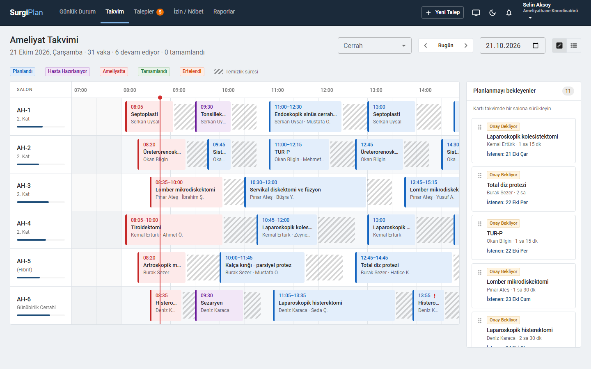

## İçindekiler

- [Özellikler](#özellikler)
- [Roller ve yetkiler](#roller-ve-yetkiler)
- [Nasıl kullanılır](#nasıl-kullanılır)
- [E-posta bildirimleri](#e-posta-bildirimleri)
- [Ekran görüntüleri](#ekran-görüntüleri)
- [Kurulum](#kurulum)
- [Teknik yapı](#teknik-yapı)

## Özellikler

- **Ameliyat takvimi:** Salon × saat ızgarası; her vakadan sonra salonun temizlik süresi taralı alan olarak gösterilir. Koordinatör bekleyen talepleri ya da mevcut vakaları sürükleyip bırakır, bırakmadan önce hedef saatin uygun olup olmadığını görür.
- **Çakışma kontrolü:** Salon, operatör, anestezi uzmanı, ekip üyeleri, ekipman adedi (ör. 3 adet C-kollu skopi), izin/nöbet kayıtları, temizlik süresi ve mesai saatleri birlikte kontrol edilir. İki koordinatör aynı anda aynı salona vaka koymaya çalışsa bile çift kayıt oluşmaz.
- **Talep akışı:** Taslak → Onay bekliyor → Planlandı → Hasta hazırlanıyor → Ameliyatta → Tamamlandı. Erteleme ve iptal gerekçe ister, gerekçeler raporlara yansır.
- **Güvenli cerrahi kontrol listesi:** DSÖ listesine göre Giriş, Mola ve Çıkış aşamaları. Liste tamamlanmadan ameliyat başlatılamaz ya da bitirilemez; her maddeyi kimin ne zaman işaretlediği kaydedilir.
- **Canlı pano:** Koridor ve ameliyathane girişindeki ekranlar için tam ekran görünüm. Değişiklikler anında yansır, hasta adları yalnızca baş harflerle gösterilir.
- **Süre tahmini:** Yeni talepte süre, cerrahın aynı işlemdeki son vakalarının gerçek sürelerinden önerilir.
- **Raporlar:** Salon doluluğu, ilk vakanın zamanında başlama oranı, iptal/erteleme nedenleri, tahmini ve gerçek süre karşılaştırması. CSV olarak indirilebilir.
- **Yönetim:** Kullanıcılar e-postayla davet edilir, şifrelerini kendileri belirler. Salon, ekipman ve işlem kataloğu yönetimi. Tüm kritik işlemler denetim izine yazılır.
- Açık ve koyu tema; tablet ve telefonda da kullanılabilir.

## Roller ve yetkiler

| Rol | Ne yapar |
|---|---|
| **Sistem Yöneticisi** | Kullanıcıları davet eder, rollerini ve branşlarını düzenler, kilitli hesapları açar, oturumları sonlandırır. Salon, ekipman ve işlem kataloğunu yönetir. Denetim izini görüntüler. Diğer tüm rollerin yetkilerine sahiptir. |
| **Ameliyathane Koordinatörü** | Onay bekleyen talepleri inceler ve takvimde bir salona yerleştirir, gerekirse düzeltme için geri gönderir. Planlanmış vakaları taşır, erteler ya da iptal eder. Anestezi uzmanını atar. Tüm ekibin izin ve nöbet kayıtlarını yönetir. Raporları görür. |
| **Cerrah** | Kendi vakaları için ameliyat talebi oluşturur ve onaya gönderir. Asistanının hazırladığı taslakları onaylayıp gönderir. Kendi vakalarını erteleyebilir ya da iptal edebilir. Kendi izinlerini girer. |
| **Asistan Doktor** | Sorumlu hekimi adına talep taslağı hazırlar; taslak cerrahın onayına gider. Sorumlu hekiminin vakalarını ve ekibinde olduğu vakaları görür. |
| **Anestezi Uzmanı** | Tüm vakaları görür. Güvenli cerrahi kontrol listesini işaretler. Vakayı hazırlığa alır, ameliyatı başlatır ve bitirir. Gerekirse hazırlık aşamasında erteleyebilir. |
| **Sorumlu Hemşire** | Tüm vakaları görür. Kontrol listesini işaretler, vakayı hazırlığa alır, ameliyatı başlatır ve bitirir. |
| **Sekreter** | Hasta kaydı açar, cerrah adına talep oluşturur, tüm vakaları ve raporları görüntüler. |

Cerrah ve asistanlar yalnızca kendi vakaları üzerinde işlem yapabilir; bu kontrol arayüzde değil sunucuda yapılır.

## Nasıl kullanılır

### 1. Talep oluşturma (cerrah, asistan, sekreter)

1. Üst menüden **Yeni Talep**'e tıklayın.
2. **Hasta:** Ad, soyad ya da protokol numarasıyla arayın. Sistemde yoksa "Sistemde olmayan hasta ekle" ile kaydedin. Hastanın alerjisi varsa uyarı gösterilir.
3. **İşlem:** Branş ve işlemi seçin; taraf, anestezi tipi, öncelik (Elektif / Öncelikli / Acil) ve istenen tarihi girin. Tahmini süre, geçmiş vakalardan otomatik önerilir.
4. **Ekip ve ekipman:** Asistan ve hemşireleri ekleyin, gerekli ekipmanı seçin (laparoskopi kulesi, C-kollu skopi vb.).
5. **Özet:** Kontrol edip **Onaya gönder** deyin. Asistanlar yalnızca taslak kaydedebilir; taslak sorumlu hekime bildirim olarak düşer.

Talep koordinatörlere bildirim olarak gider.

### 2. Planlama (koordinatör)

1. **Takvim** sayfasında sağdaki **Planlanmayı bekleyenler** listesinden bir kartı tutup ilgili salonun satırına sürükleyin.
2. Sürüklerken hedef alan yeşil (uygun), turuncu (uyarı, ör. mesai dışı) ya da kırmızı (çakışma) görünür; kırmızıda sebebi yazar.
3. Bıraktığınızda planlama penceresi açılır. Saati, süreyi ve anestezi uzmanını burada ayarlayabilirsiniz; çakışma kontrolü siz değiştirdikçe yeniden yapılır.
4. **Planla ve bildir** ile kaydedin. Operatör, anestezi ve ekipteki herkes e-posta ve uygulama içi bildirim alır.

Aynı işlem **Talepler** sayfasındaki **Planla** butonuyla da yapılabilir. Planlanmış bir vakayı başka bir saate sürükleyerek taşıyabilirsiniz; ekibe "plan değişikliği" e-postası gider.

### 3. Ameliyat günü (hemşire, anestezi)

1. **Vakalarım** ya da **Takvim** üzerinden vakayı açın.
2. **Hazırlığa Al** ile hastanın hazırlandığını işaretleyin.
3. **Güvenli cerrahi kontrol listesi**ndeki Giriş ve Mola maddelerini işaretleyin. Bunlar tamamlanmadan **Ameliyatı Başlat** çalışmaz.
4. Ameliyat bitince Çıkış maddelerini işaretleyip **Ameliyatı Bitir** deyin. Gerçek başlangıç ve bitiş saatleri kaydedilir, raporlarda tahminle karşılaştırılır.

Durum değiştikçe takvim, günlük durum ekranı ve canlı pano sayfa yenilemeden güncellenir.

### 4. Erteleme ve iptal

Vaka sayfasındaki **Ertele** ya da **İptal Et** butonları gerekçe ister. Sık kullanılan gerekçeler tek tıkla seçilebilir. Ertelenen vaka salonu boşaltır ve daha sonra yeniden planlanabilir. Ekibe e-posta gider.

### 5. İzin ve nöbet

**İzin / Nöbet** sayfasından izin, kongre ya da nöbet ertesi günleri girilir. Bu tarihlerde kişiye vaka planlanmaya çalışılırsa sistem engeller.

### 6. Yönetim

- **Kullanıcılar:** "Kullanıcı davet et" ile e-posta, ad, rol ve branş girilir. Kişiye şifre belirleme bağlantısı gider (3 gün geçerli). Asistanlar için sorumlu hekim seçilir.
- **Salon ve Katalog:** Salonların temizlik süresi, ekipman adetleri ve işlemlerin katalog süreleri buradan yönetilir.
- **Denetim İzi:** Kim, ne zaman, neyi değiştirdi; giriş denemeleri dahil.

## E-posta bildirimleri

| Ne zaman | Kime |
|---|---|
| Kullanıcı davet edildiğinde | Davet edilen kişi (şifre belirleme bağlantısı) |
| Şifre sıfırlama istendiğinde | Kullanıcı (1 saat geçerli bağlantı) |
| Vaka planlandığında | Operatör, anestezi uzmanı ve ekip (her biri kendi göreviyle) |
| Vakanın saati ya da salonu değiştiğinde | Ekipteki herkes (eski ve yeni plan) |
| Planlanmış vaka ertelendiğinde / iptal edildiğinde | Ekipteki herkes (gerekçe ve işlemi yapan kişi) |
| Her gün 17:00 | Ertesi gün vakası olan herkes (günlük liste) |

Kullanıcılar e-posta bildirimlerini **Profil ve ayarlar** sayfasından kapatabilir; uygulama içi bildirimler her zaman gelir. Geliştirme ortamında giden tüm e-postalar MailHog'da (http://localhost:8026) görülür.

## Ekran görüntüleri

| | |
|---|---|
| 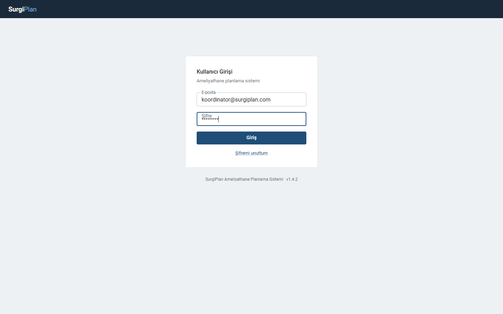 Giriş | 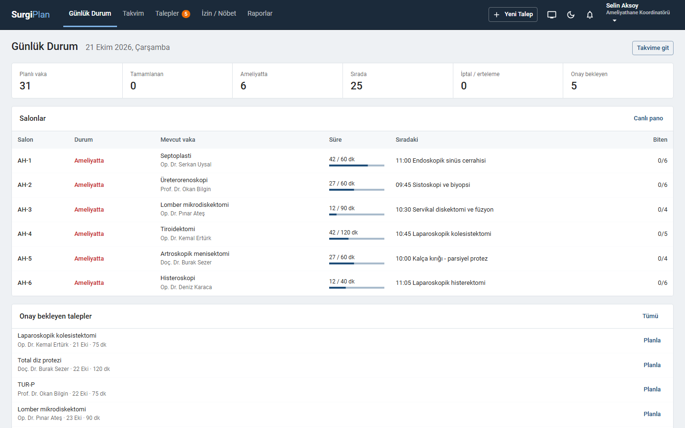 Günlük durum |
|  Ameliyat takvimi | 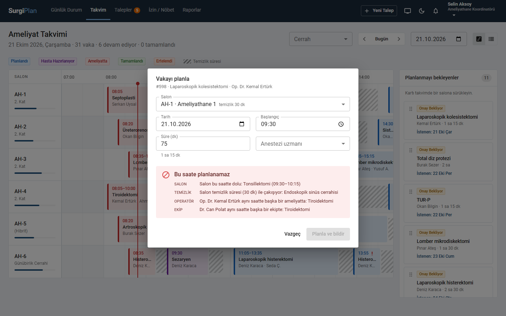 Sürükle-bırak ile planlama ve çakışma kontrolü |
| 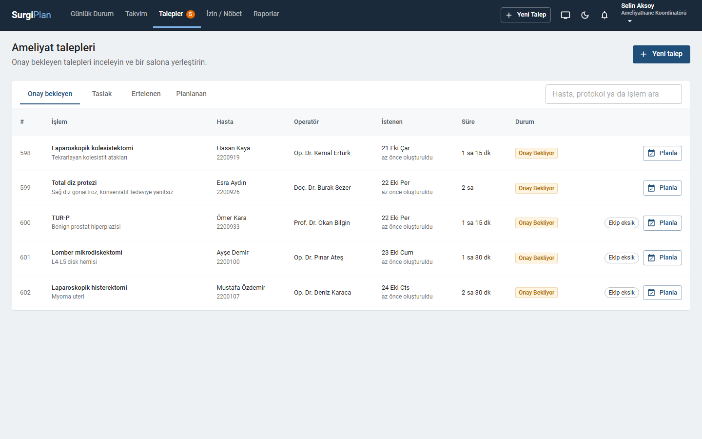 Talepler | 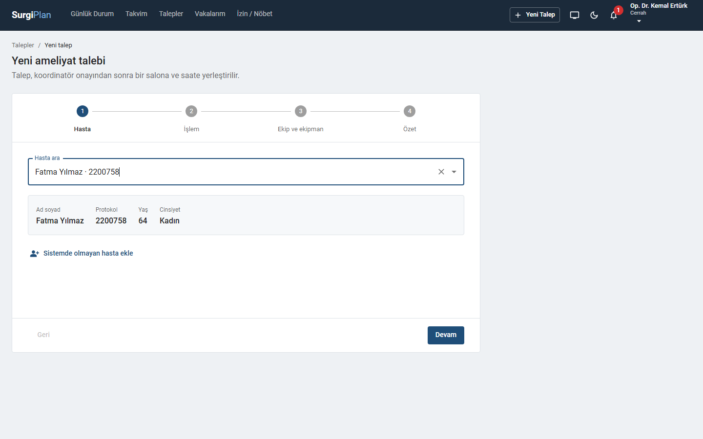 Yeni talep sihirbazı |
| 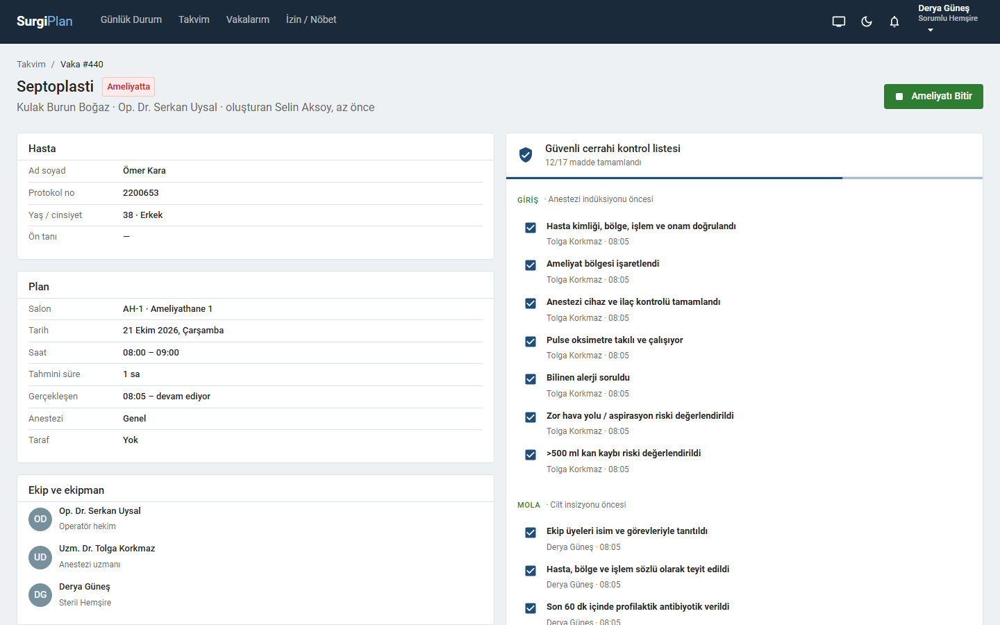 Vaka detayı ve kontrol listesi | 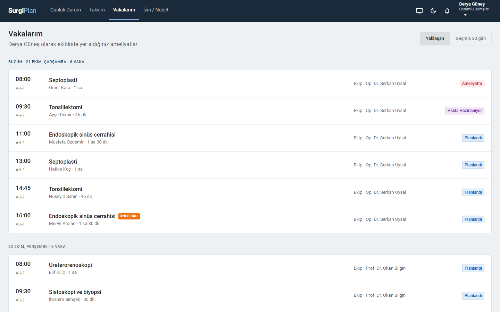 Vakalarım |
| 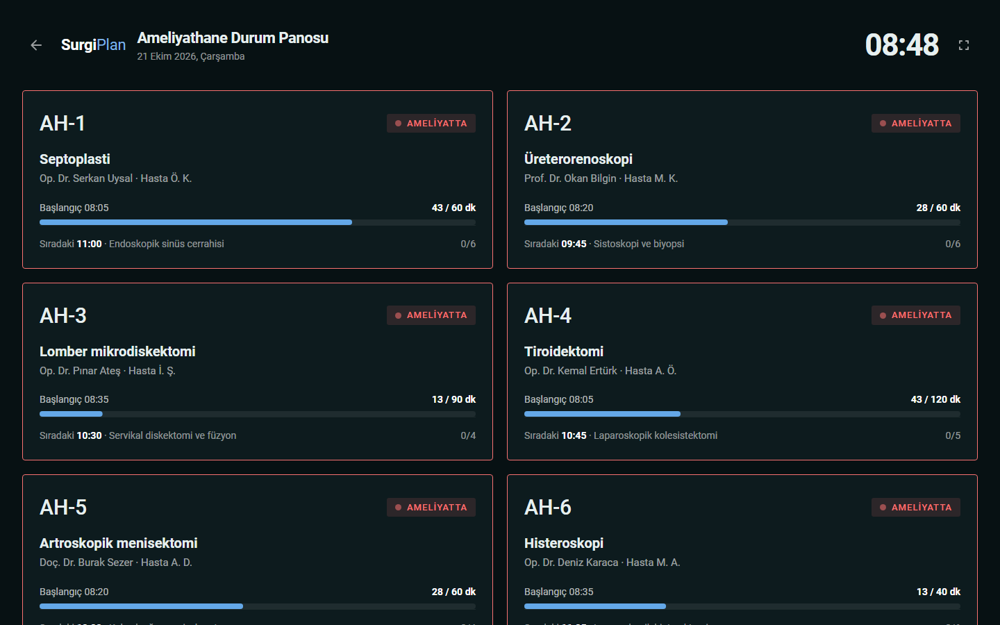 Canlı pano | 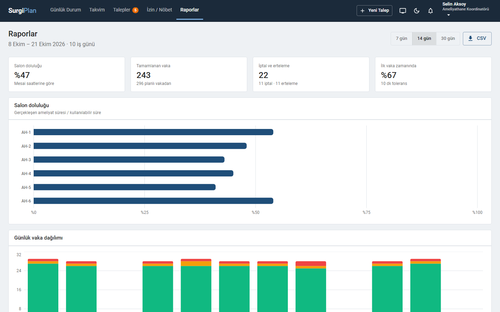 Raporlar |
| 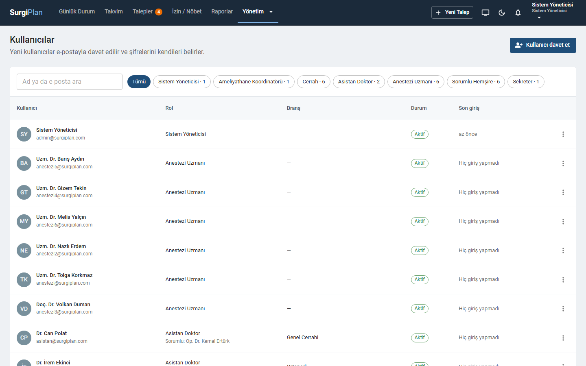 Kullanıcı yönetimi | 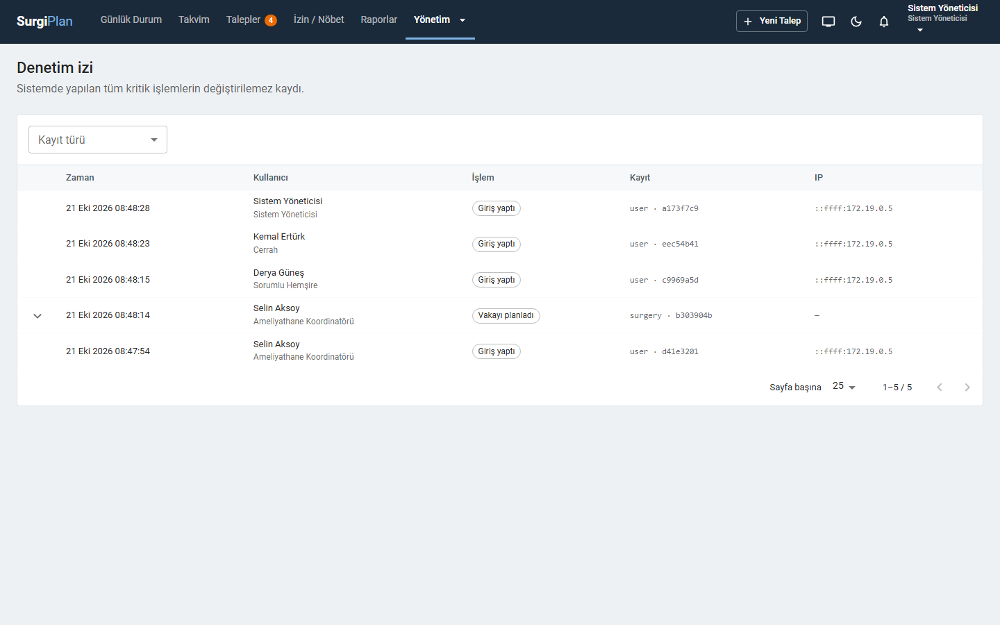 Denetim izi |
| 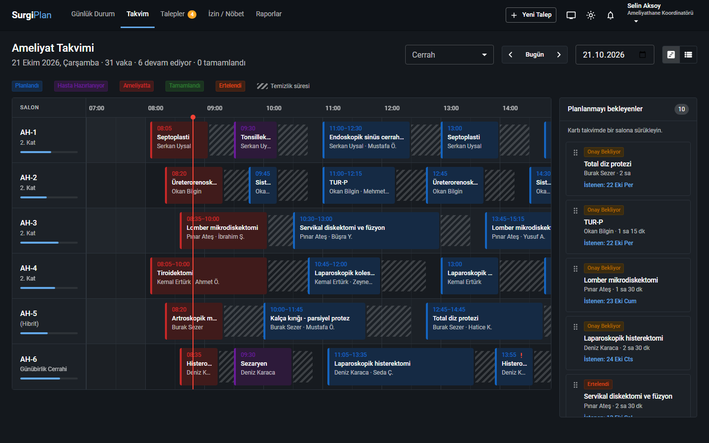 Koyu tema | 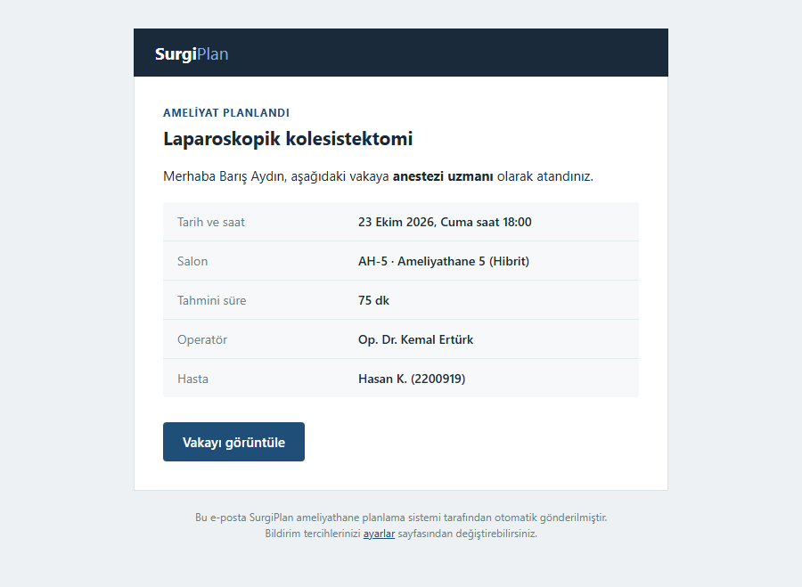 Vaka atama e-postası |

## Kurulum

Gereksinim: Docker.

```bash
cp .env.example .env
docker compose up -d --build
```

- Uygulama: http://localhost:8090
- Giden e-postalar (MailHog): http://localhost:8026

İlk açılışta veritabanı tabloları oluşturulur ve demo verisi yüklenir (3 haftalık geçmiş, 1 haftalık plan). Boş başlatmak için `.env` içinde `SEED_DEMO_DATA=false` yapın. Portlar başka uygulamalarla çakışırsa `.env` dosyasından değiştirilebilir.

### Demo hesapları

Tüm hesapların şifresi: `Demo1234!`

| E-posta | Rol |
|---|---|
| koordinator@surgiplan.com | Ameliyathane Koordinatörü |
| cerrah@surgiplan.com | Cerrah (Genel Cerrahi) |
| asistan@surgiplan.com | Asistan Doktor |
| anestezi@surgiplan.com | Anestezi Uzmanı |
| hemsire@surgiplan.com | Sorumlu Hemşire |
| sekreter@surgiplan.com | Sekreter |
| admin@surgiplan.com | Sistem Yöneticisi |

Geliştirme ortamı kurulumu için [İngilizce README](README.md#local-development) bölümüne bakın.

## Teknik yapı

- **Backend:** Node.js 18, NestJS 9, Prisma 4, SQL Server 2019, Socket.IO, Nodemailer
- **Frontend:** React 18, Vite 3, MUI 5, TanStack Query 4, React Hook Form, Recharts
- **Altyapı:** Docker Compose, nginx, GitHub Actions

Mimari kararlar `docs/adr` klasöründedir: çift rezervasyonun nasıl engellendiği, e-postaların neden outbox tablosu üzerinden gönderildiği, saat dilimi yaklaşımı ve oturum yönetimi.

## Kapsam dışı

SurgiPlan bir planlama aracıdır; klinik kayıt tutmaz ve tıbbi cihaz değildir. Hastane bilgi sistemi entegrasyonu (HL7/FHIR) kapsam dışıdır, hastalar doğrudan kaydedilir.
